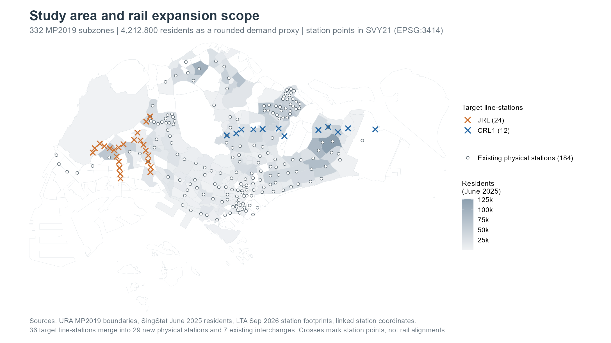
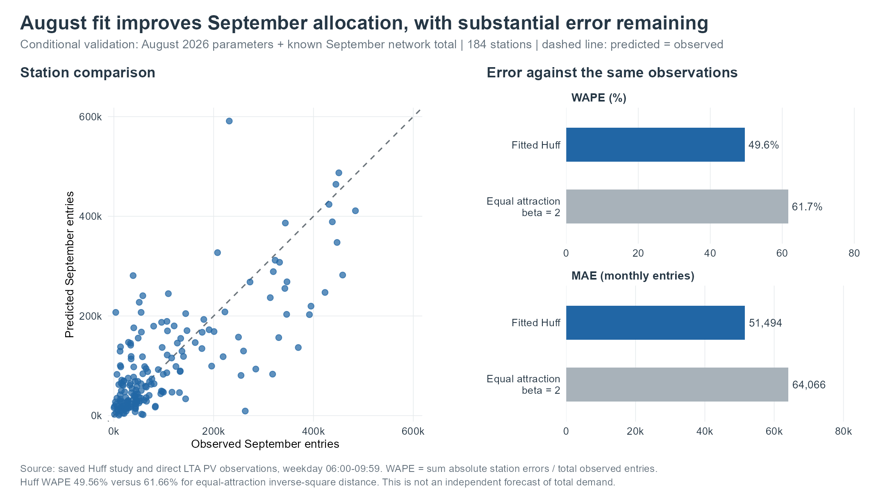
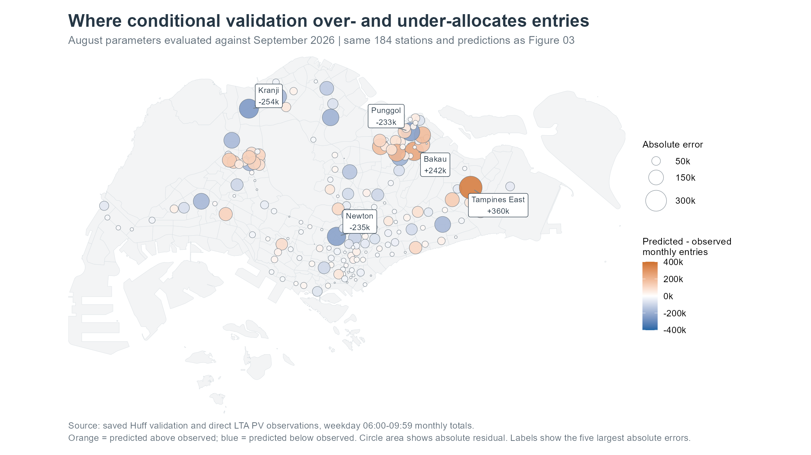
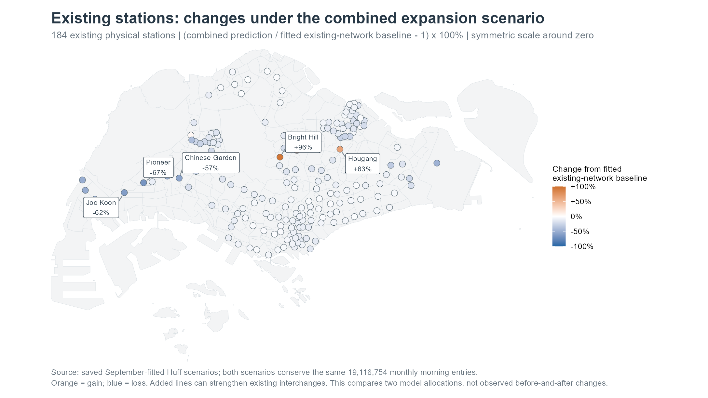
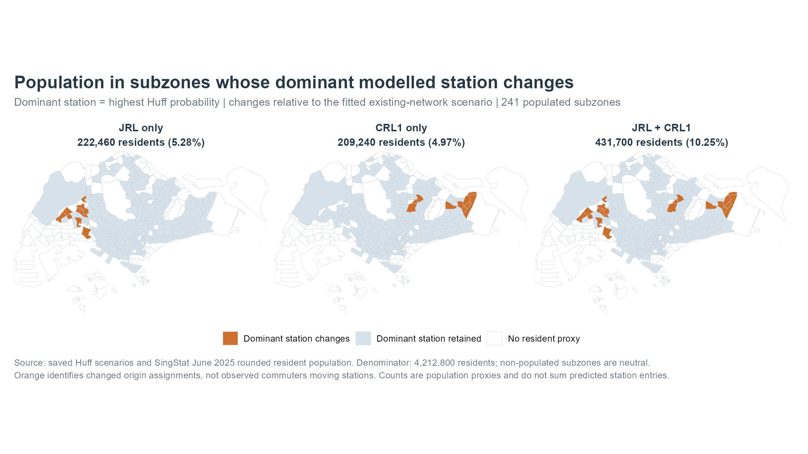

```{r}
#| include: false
source('R/workflow.R',local=TRUE)
verify_ex03_analysis()
study <- readRDS('output/huff-study.rds')
p <- readRDS('data/processed/public-prepared.rds')
fmt <- function(x) format(round(x),big.mark=',',trim=TRUE,scientific=FALSE)
august <- read.csv('output/tables/observed-202608.csv', stringsAsFactors=FALSE)
v <- study$validation
stopifnot(!anyDuplicated(august$station_id), !anyDuplicated(v$station_id),
          setequal(august$station_id,v$station_id))
previous_entries <- august$observed_boardings[match(v$station_id,august$station_id)]
history_prediction <- previous_entries/sum(previous_entries)*sum(v$observed)
history_wape <- sum(abs(history_prediction-v$observed))/sum(v$observed)
```

## Questions and scope

1. Can a calibrated Huff model estimate existing station entry allocations?
2. Which proposed stations attract more of the current residential market?
3. How do existing station allocations and dominant catchments change?

**Singapore MRT and LRT · workdays 06:00–09:59**

The outcome is monthly tap-in entries. August 2026 calibrates the model; September checks its allocation and supplies the final scenario baseline.

::: {.source-note}
Sources: LTA DataMall monthly passenger files and station/bus layers; SingStat June 2025 residents; URA MP2019 boundaries. The expansion is the assignment's original JRL (24 stations) and CRL Phase 1 (12 stations) scope.
:::

## Prepare the market before modelling

::: {.columns}
::: {.column width="65%"}
{.map-image}
:::
::: {.column width="32%"}
- **241** populated origins from 332 subzones.
- **184** physical existing stations from 185 reported units.
- **29** new physical choices after merging 7 existing interchanges.
- Direct PV tap-ins control the response; OD-origin sums are about 0.6% lower.
:::
:::

::: {.source-note}
The supplied 2025 population is matched to MP2019. Stevens' separate DT10/TE11 records are combined. Line-station additions and physical station additions differ.
:::

## Calibrate, then check September

{.wide-image}

September validation WAPE: **49.56% Huff**, **61.66% distance-only**, and **`r sprintf('%.2f%%',100*history_wape)` August-share reference**. Final refit parameters: γ = 1.352, β = 2.419.

::: {.source-note}
All comparisons use the known September total. August shares perform better at existing stations; new stations have no observed history. Attraction=(1+bus stops within 500 m)×rail-line count; distance ≥100 m. The chart compares the two spatial allocations.
:::

## The remaining errors matter

::: {.columns}
::: {.column width="67%"}
{.map-image}
:::
::: {.column width="30%"}
Largest examples:

- Tampines East: **+359,913** entries.
- Kranji: **−254,072** entries.
- Bakau: **+242,401** entries.

Residual=prediction−observation.
:::
:::

::: {.source-note}
Whole-subzone origins, straight-line distances and a residential market can miss local access and trip-generation differences. These are possible explanations, not causes established by the residual map.
:::

## New stations: conditional allocations

| Combined expansion: leading new stations | Modelled monthly entries |
|---|---:|
| Pasir Ris East |284,664|
| Tampines North |175,550|
| Choa Chu Kang West |160,449|
| Gek Poh |159,115|
| Serangoon North |128,668|

All 29 new physical stations receive **`r fmt(sum(study$scenarios$both$changes$predicted[study$scenarios$both$changes$status=='new']))` entries**, or 10.37% of the fixed network market.

::: {.source-note}
September-equivalent weekday morning entries under current population and bus supply. These are scenario allocations, not actual 2030 demand forecasts. Proposed platforms at existing interchanges remain part of those stations.
:::

## Existing stations: gains and redistribution

::: {.columns}
::: {.column width="67%"}
{.map-image}
:::
::: {.column width="30%"}
Combined scenario:

- Hougang: **+150,571** entries.
- Ang Mo Kio: **+88,078**.
- Pioneer: **−261,215**.

Existing stations lose 1.98 million entries in net terms as new alternatives share the fixed market.
:::
:::

::: {.source-note}
Changes compare with the modelled existing-network baseline, not observed entries. Interchange line counts change attraction; gains do not establish additional network-wide demand.
:::

## Dominant catchments change

{.wide-image}

Subzones switching their most probable station contain **222,460 residents with JRL**, **209,240 with CRL**, and **431,700 with both**: 10.25% of the resident proxy in the combined scenario.

::: {.source-note}
These are populations of whole subzones whose model-dominant station changes, not observed passengers switching, individual switching probabilities, or new rail users. Choice probabilities remain distributed across stations.
:::

## Planning use and limits

- Use the comparisons to identify places needing better catchment and feeder-service evidence.
- **Fixed demand:** all scenarios conserve `r fmt(sum(study$market))` entries; growth, induced demand and rail transfer loads are outside the model.
- **Sensitivity:** a 250 m rather than 100 m floor leaves dominant switches unchanged but reallocates about 2.00% of entries in the combined network. Local volume changes can be large.
- **Before decisions:** add finer residential origins, employment/activity data and realistic access networks; validate future station choices with observed evidence.

::: {.source-note}
Huff validation WAPE is 49.56%, versus `r sprintf('%.2f%%',100*history_wape)` for August shares. Treat expansion rankings and gains/losses as conditional planning hypotheses requiring stronger validation. Full methods, source links, estimates and reproducible R code are in the technical report.
:::
